# RigControl - Dashboard

A self-hosted rig monitoring dashboard for Ubuntu Server / Windows rigs, Clore AI, Octaspace, Salad Hosts etc. Built with a Python telemetry agent, MQTT-based dashboard server, and a webpage frontend.

--> [Design](#design)

Dashboard... Docker / miner details popout

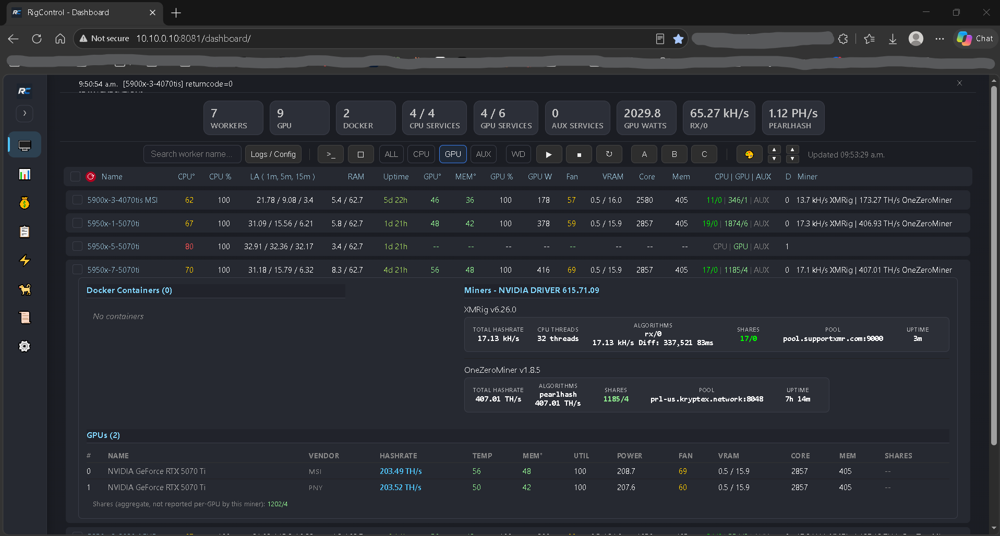

Flightsheets... Apply to

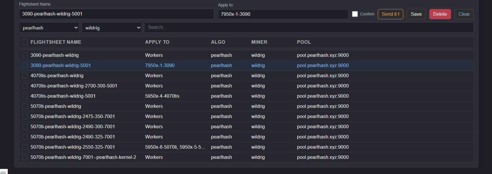

# Work in progress...

> redesigned install paths... use binary short names etc

```
sudo mkdir -p /opt/miners/custom
sudo cp -a /opt/miners/keryx-miner /opt/miners/custom/keryx-miner
```

> updated Stats:
>
> Full chart order now: Hashrate, GPU Core Clock, GPU Mem Clock, GPU Power, GPU VRAM, GPU Utl, GPU Temp,
>
> RAM Usage, Load Average, CPU Utl, CPU Temp.
>
> windows agent notes for running services, not tested
>

# Get started

- [rigcontrol_dashboard_server_windows](rigcontrol_dashboard_server_windows)
- [rigcontrol_dashboard_server_pi](rigcontrol_dashboard_server_pi)
- [static](static)
- [rigcontrol_agent](rigcontrol_agent)
- [Miner-scripts](Miner-scripts)
- [Docker-Events](Miner-scripts/Docker-Events)
- [py-nvtool](py-nvtool/py-nvtool-install-usage.txt)
- [Overclocks](Overclocks)
- [gpu-vram-temps](py-nvtool/gpu-vram-temps)
- [Fan-control](Fan-control)
- [themes](themes)

X-files

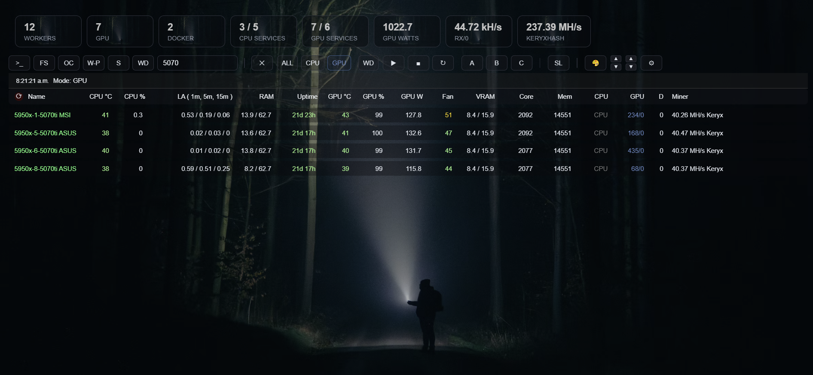

Fallout

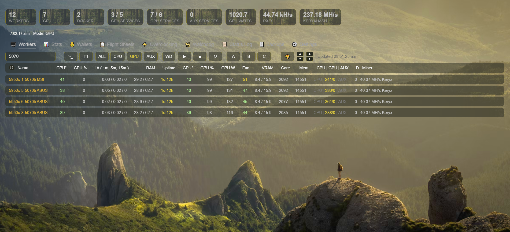

Alien

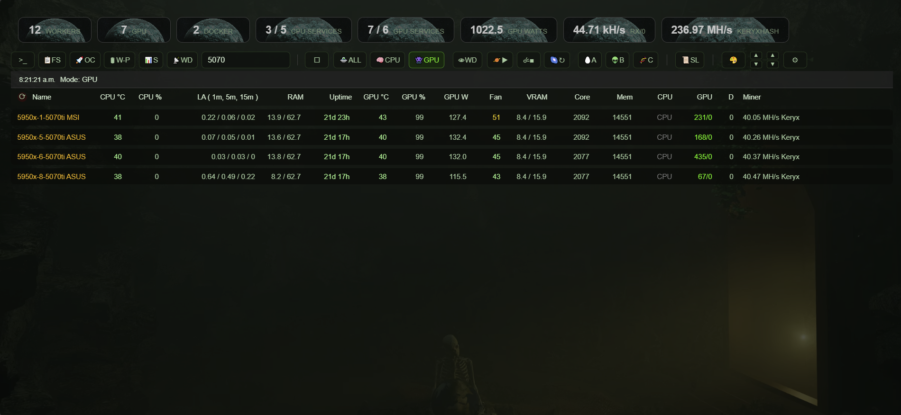

Phantom Menace

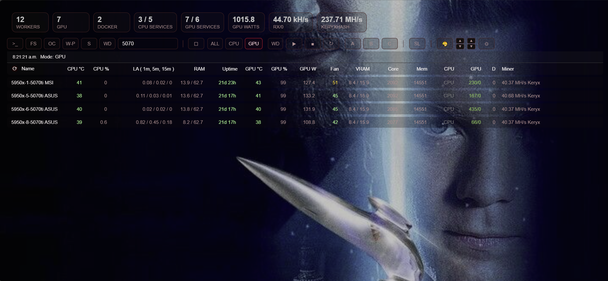

# Design:

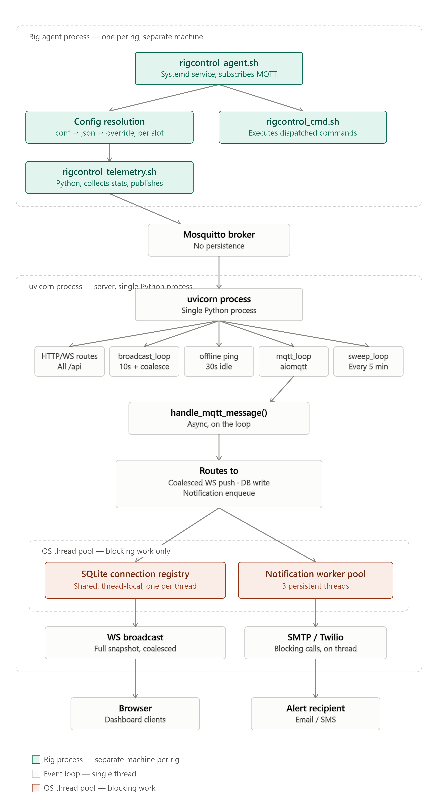

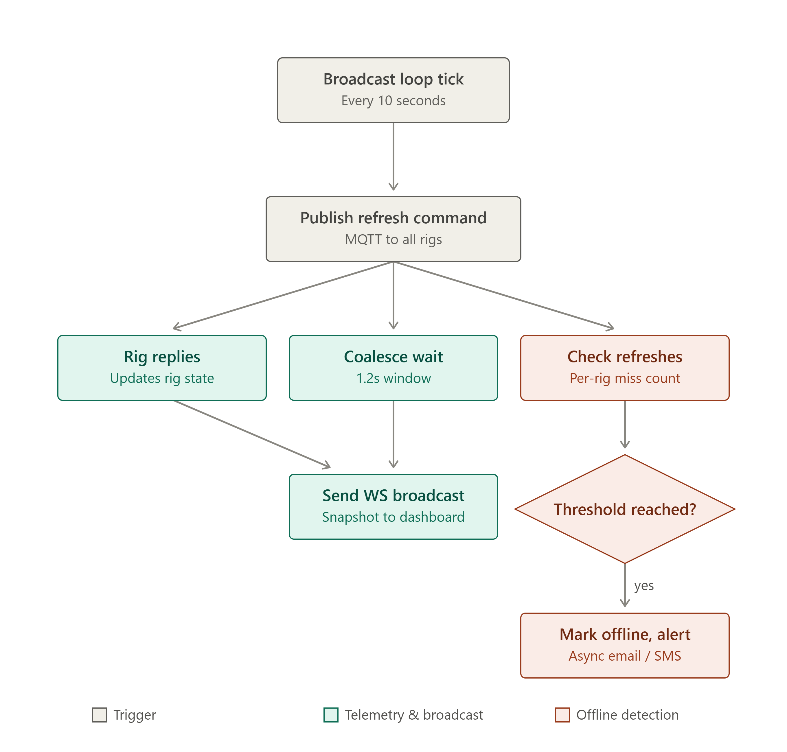

Render tuning... Advanced Server Settings

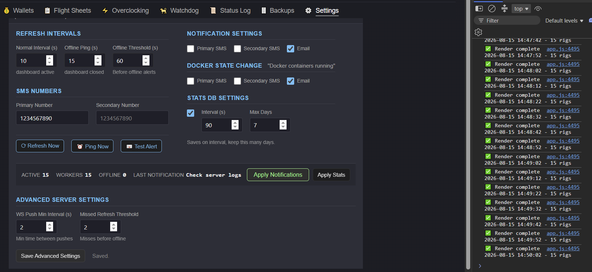

Themes... saved to browser data, profiles save on server

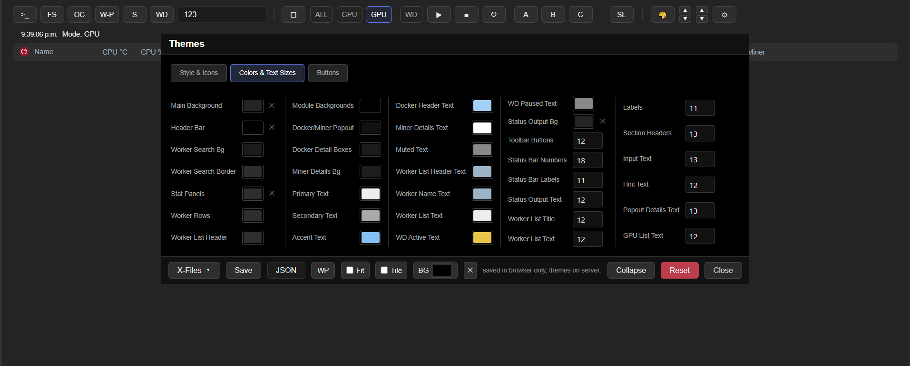

Multi-gpu pane in details popout, main list shows total watts, highest temp, highest watts, etc

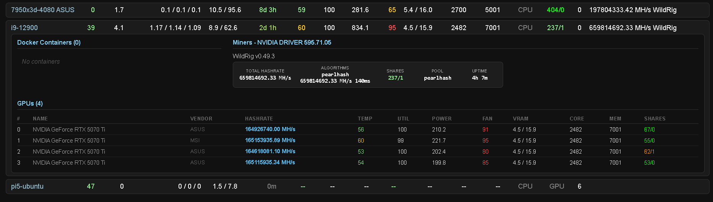

Search workers multi term coma seperated

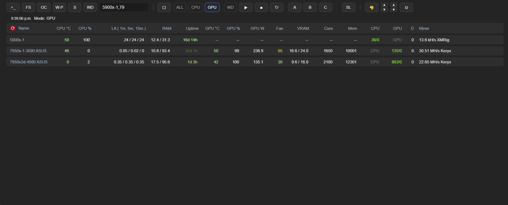

Rig Statistics -- saves to rig local db, skip gpu stats with override rules still apply

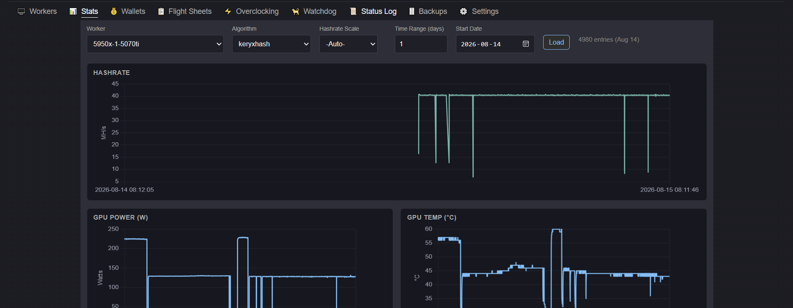

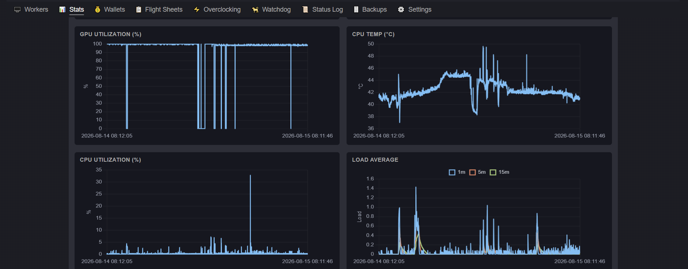

Remote access view only mode... with email unlock [2FA.md](rigcontrol_dashboard_server_pi/2FA.md)

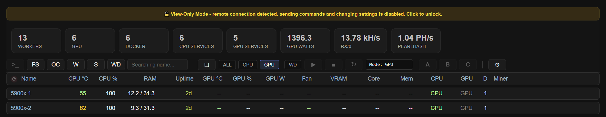

Unlock... 3 attempts per 24h, 60 second sleep

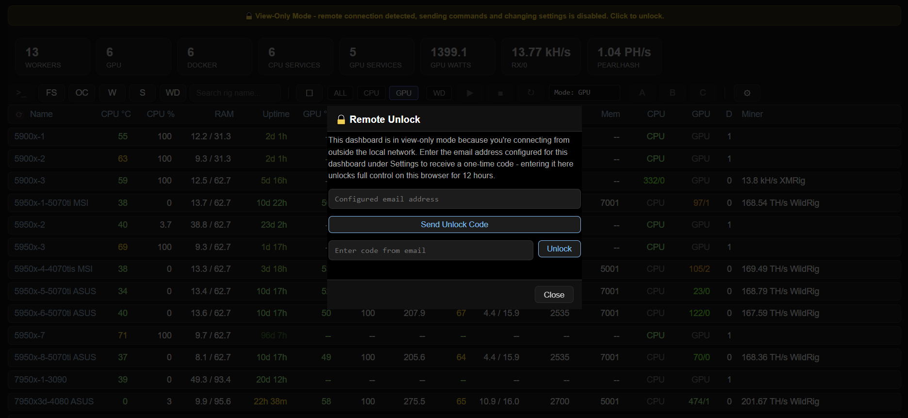

Unlock email...

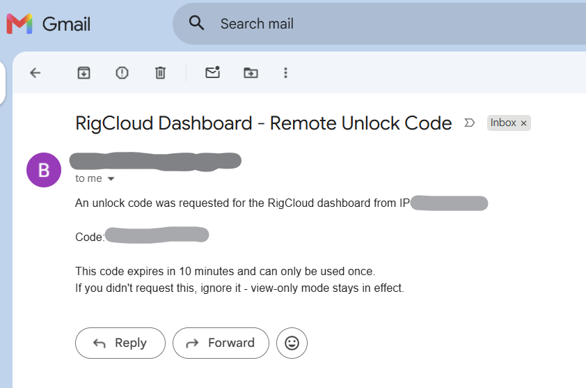

[RigControl - Dashboard](#rigcontrol---dashboard)

[Get started](#get-started)

---

## Support

Donations are appreciated:

MetaMask supported chains (Base/Eth/Clore)
  

```
0xe65b5d7B7D43D77eF585CCF4a675832d0d23f806
```
