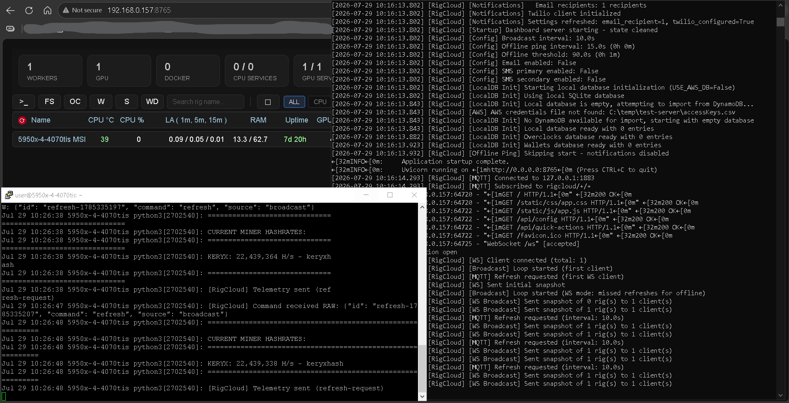

[Get started](../README.md#get-started)

** update.. 'OSN_PRIMARY=0' (default): local GPU/CPU/memory stats. Set 'OSN_PRIMARY=1' to use OctaSpace node (osn) metrics instead. **

** updated agent to use .venv virtual environment, uninstall not needed requirements from system **

## Guides

- [Agent setup](ubuntu/agent-setup-guide.md): install / update the agent on a worker
- [Basic TLS](../rigcontrol_dashboard_server_pi/mosquitto-tls-setup.txt): encrypted MQTT (the default)
- [Advanced TLS](../rigcontrol_dashboard_server_pi/mosquitto-tls-advanced.txt): client certificates (mutual TLS)
- [No TLS](../rigcontrol_dashboard_server_pi/mosquitto-no-tls-setup.txt): plain MQTT

Ubuntu 24.04:

```
sudo python3 -m pip uninstall -y aiomqtt typing_extensions paho-mqtt --break-system-packages
```

Ubuntu 22.04:

```
sudo python3 -m pip uninstall -y aiomqtt typing_extensions paho-mqtt
```

## Telemetry flow (each poll)

- **Agent start:** one full local GPU read (unless the GPUs are in passthrough / blocked), cached: power limits (min/default/max), vbios, board partner, architecture, PCI slot, VRAM total. Reused on every poll; never repeated on refresh.
- **1. Local passthrough check:** GPUs bound to `vfio-pci` (sysfs) belong to a VM. Runs first, before osn is asked, and cannot be overridden. GPU values are reported as `0`, no GPU tool is called.
- **2. osn is asked** (always, if installed): `osn_gpu_passthrough_active=1` gives the same result as step 1.
- **3. Docker rules:** a running container matching `BLOCK_LIST` always skips GPU stats (values `0`). Optional `DOCKER_SKIP_GPU_STATS=1` also skips while any non-miner container runs (empty GPU list).
- **4. GPU stats source:**
  - `OSN_PRIMARY=0` (default): local `nvidia-smi` / `rocm-smi` / gputemps through the GPU tool guard.
  - `OSN_PRIMARY=1`: GPU, CPU and memory come from osn only, no local GPU fallback. Static values are filled from the start-up cache; osn unreachable gives `-1` values.
- **GPU tool guard:** every local GPU call has a 5s timeout. A timeout blocks the tool until the agent restarts; any other failure pauses it 30s, and a second failure in a row blocks it. Paused or blocked tools report `-1` values (`stats_failed` / `stats_error` say why).
- **5. Miner stats** always come from the miner APIs / logs. Load, network, uptime, docker and service status are collected locally.
- **6. Reply:** one universal payload (`gpus[]` with temp, util, `power_watts` + `power_limit`, clocks, `coreoffset`, VRAM, ...). The dashboard combines used/limit watts for display. The log's "Stats source" line shows where each part came from.

Value meaning on the dashboard: `0` = intentionally not read (passthrough / `BLOCK_LIST`), `-1` = read failed, `--` = not reported.

## USER FLAG DESCRIPTION (`/etc/rigcontrol/rigcontrol-agent.conf`, read live)

- `OSN_PRIMARY=0` (default): local GPU/CPU/memory stats. Set `OSN_PRIMARY=1` to use OctaSpace node (osn) metrics instead.
- `OSN_ALLOW_MISSING_GPU_STATS=1` also fetch what osn leaves out and needs no `nvidia-smi` (live mem temp via gputemps, lspci/proc fallbacks); `0` skips that. The start-up read happens regardless.
- `DOCKER_SKIP_GPU_STATS=0` (default off) skip GPU stats while a non-miner container is running. Passthrough always skips.
- `OVERRIDE_LIST=""` docker images that are "GPU stats safe" and ignored by the docker rule (keyword match anywhere in the image name, case-insensitive).
- `BLOCK_LIST=""` docker images that ALWAYS skip GPU stats while running (same keyword match as `OVERRIDE_LIST`).
- `STATS_DB_ENABLED`, `STATS_DB_MAX_HISTORY_DAYS`, `STATS_DB_INTERVAL_SECONDS` local stats history.
- `MIN_TELEMETRY_PULL_INTERVAL_SECONDS=5` minimum gap between telemetry pulls.
- `CPU_SERVICE_NAME`, `GPU_SERVICE_NAME`, `AUX_SERVICE_NAME`, `WATCHDOG_SERVICE_NAME` custom agent service names for dashboard control.
- `CUSTOM_MINER_BIN_GPU` / `_CPU` / `_AUX` custom miner binaries to detect.
- `<NAME>_BIN` binary for a custom miner, keyed by the miner's own name (`CUSTOM_MINER` in `rig-gpu/cpu/aux.conf` or `.json`, sanitized to A-Z0-9_).
- `<NAME>_API_HOST` / `<NAME>_API_PORT` custom miner JSON stats API (e.g. `KERYX_MINER_API_PORT=3338`, `SUPRMINER_NEPTUNE_API_PORT=4068`).
- `<NAME>_LOG_PATH` custom miner log file to scrape for stats when there is no API.
- `<NAME>_LOG_STYLE` how that log is read: `blocks` counts keryxd-style "Accepted N blocks"; unset uses generic hashrate scraping.
- `EXCLUDE_FROM_TOTALS = True` (in `rigcontrol_telemetry.sh`) leaves a dashboard host out of the status totals.

mqtt is encrypted (TLS) by default. copy the broker's `ca.crt` to each worker once (it is public, `ca.key` stays on the broker), then set `BROKER_HOST`, `BROKER_USER`, `BROKER_PASS` in the script. for plain mqtt set `MQTT_TLS=0` and `BROKER_PORT=1883`

## Recommended

reserve the port range used for rental services (replace 51000-52000 with yours), so outgoing connections like the agent's mqtt never use a rental port. services can still bind these ports.

```
echo "net.ipv4.ip_local_reserved_ports = 51000-52000" | sudo tee /etc/sysctl.d/99-rental-ports.conf
sudo sysctl --system
cat /proc/sys/net/ipv4/ip_local_reserved_ports
```

Useful commands:

show service status:

```bash
systemctl status rigcontrol-agent.service --no-pager
```

follow the agent log: ctrl+c to break/exit

```bash
journalctl -u rigcontrol-agent.service -f
```

show the last 100 log lines:

```bash
journalctl -u rigcontrol-agent.service -n 100 --no-pager
```

reload systemd after editing the service file:

```bash
sudo systemctl daemon-reload
```

enable start on boot:

```bash
sudo systemctl enable rigcontrol-agent.service
```

disable start on boot:

```bash
sudo systemctl disable rigcontrol-agent.service
```

start the agent:

```bash
sudo systemctl start rigcontrol-agent.service
```

stop the agent:

```bash
sudo systemctl stop rigcontrol-agent.service
```

restart the agent:

```bash
sudo systemctl restart rigcontrol-agent.service
```



[rigcontrol-agent-local-keryxd.sh](ubuntu/rigcontrol-agent-local-keryxd.sh)... keryxd node: aux service name,binary location,log,log type

```
sudo tee /etc/rigcontrol/rigcontrol-agent.conf > /dev/null <<'EOF'
# ===== SERVER SETTINGS (dashboard server MQTT broker) =====
BROKER_HOST=10.10.0.10
BROKER_PORT=8883
BROKER_USER=admin
BROKER_PASS=CHANGE_ME
# --- BASIC TLS: broker certificate verified with ca.crt (mosquitto-tls-setup.txt) ---
MQTT_TLS=1
MQTT_CA_FILE=/etc/rigcontrol/ca.crt
# --- END BASIC TLS ---
# --- ADVANCED TLS: client certificate (mutual TLS), uncomment when the broker has require_certificate true (mosquitto-tls-advanced.txt) ---
#MQTT_CLIENT_CERT=/etc/rigcontrol/client.crt
#MQTT_CLIENT_KEY=/etc/rigcontrol/client.key
# --- END ADVANCED TLS ---
# --- TEST TLS: skip certificate and hostname verification, testing only ---
#MQTT_TLS_INSECURE=1
# --- END TEST TLS ---
MIN_TELEMETRY_PULL_INTERVAL_SECONDS=5
# ===== END SERVER SETTINGS =====
# ===== USER FLAG DESCRIPTION (rigcontrol-agent.conf, read live) =====
# BROKER_HOST / BROKER_PORT / BROKER_USER / BROKER_PASS: MQTT broker (dashboard server) the agent connects to
# MQTT_TLS (default 1): 1 = encrypted connection to the broker (BROKER_PORT = broker TLS port, 8883), 0 = plain MQTT (BROKER_PORT 1883)
# MQTT_CA_FILE: CA certificate that signed the broker certificate (copy the broker's ca.crt to this path once; empty = system CAs)
# MQTT_CLIENT_CERT / MQTT_CLIENT_KEY: client certificate and key, only if the broker requires them
# MQTT_TLS_INSECURE (default 0): 1 = skip certificate/hostname verification (testing only)
# MIN_TELEMETRY_PULL_INTERVAL_SECONDS: minimum seconds between telemetry pulls
# OSN_PRIMARY (default 0): 1 = GPU + CPU/memory from OctaSpace osn only, no local GPU fallback; 0 = ignore osn, collect locally
# OSN_ALLOW_MISSING_GPU_STATS (default 1): with osn, also fetch what it leaves out without nvidia-smi (mem temp, lspci/proc); the start-up read happens regardless
# DOCKER_SKIP_GPU_STATS (default 0): 1 = skip GPU stats while a non-miner docker container is running
# OVERRIDE_LIST: docker image keywords that are GPU-stats safe (keyword match anywhere in the image name)
# BLOCK_LIST: docker image keywords that ALWAYS skip GPU stats while running (same match, values report 0)
# STATS_DB_ENABLED / STATS_DB_MAX_HISTORY_DAYS / STATS_DB_INTERVAL_SECONDS: local stats history on/off, days kept, seconds between samples
# CPU_SERVICE_NAME / GPU_SERVICE_NAME / AUX_SERVICE_NAME / WATCHDOG_SERVICE_NAME: service names the dashboard controls
# CUSTOM_MINER_BIN_GPU / _CPU / _AUX: custom miner binary per slot
# <NAME>_BIN / _API_HOST / _API_PORT / _LOG_PATH / _LOG_STYLE: per custom miner, NAME = miner name as A-Z0-9_ (LOG_STYLE=blocks counts "Accepted N blocks")
# ===== END USER FLAG DESCRIPTION =====
OSN_PRIMARY=0
#OSN_ALLOW_MISSING_GPU_STATS=1
#DOCKER_SKIP_GPU_STATS=0
OVERRIDE_LIST="miner/miner:latest"
BLOCK_LIST=""
STATS_DB_ENABLED=true
STATS_DB_MAX_HISTORY_DAYS=7
STATS_DB_INTERVAL_SECONDS=90
#CPU_SERVICE_NAME=docker_events_cpu.service
#GPU_SERVICE_NAME=docker_events_gpu.service
AUX_SERVICE_NAME=keryxd.service
#WATCHDOG_SERVICE_NAME=rigcontrol_watchdog.service
#CUSTOM_MINER_BIN_GPU=/opt/miners/my-custom-miner/current/my-custom-miner
#CUSTOM_MINER_BIN_CPU=/opt/miners/my-custom-miner/current/my-custom-miner
CUSTOM_MINER_BIN_AUX=/opt/miners/keryx-node/keryxd
KERYXD_LOG_PATH=/run/rigcontrol/aux_miner.log
KERYXD_LOG_STYLE=blocks
#KERYX_MINER_API_HOST=127.0.0.1
#KERYX_MINER_API_PORT=3338
#KERYX_MINER_SUPR_API_HOST=127.0.0.1
#KERYX_MINER_SUPR_API_PORT=3338
EOF
```

[rigcontrol-agent-local.sh](ubuntu/rigcontrol-agent-local.sh)... KERYX_MINER_API

```
sudo tee /etc/rigcontrol/rigcontrol-agent.conf > /dev/null <<'EOF'
# ===== SERVER SETTINGS (dashboard server MQTT broker) =====
BROKER_HOST=10.10.0.10
BROKER_PORT=8883
BROKER_USER=admin
BROKER_PASS=CHANGE_ME
# --- BASIC TLS: broker certificate verified with ca.crt (mosquitto-tls-setup.txt) ---
MQTT_TLS=1
MQTT_CA_FILE=/etc/rigcontrol/ca.crt
# --- END BASIC TLS ---
# --- ADVANCED TLS: client certificate (mutual TLS), uncomment when the broker has require_certificate true (mosquitto-tls-advanced.txt) ---
#MQTT_CLIENT_CERT=/etc/rigcontrol/client.crt
#MQTT_CLIENT_KEY=/etc/rigcontrol/client.key
# --- END ADVANCED TLS ---
# --- TEST TLS: skip certificate and hostname verification, testing only ---
#MQTT_TLS_INSECURE=1
# --- END TEST TLS ---
MIN_TELEMETRY_PULL_INTERVAL_SECONDS=5
# ===== END SERVER SETTINGS =====
# ===== USER FLAG DESCRIPTION (rigcontrol-agent.conf, read live) =====
# BROKER_HOST / BROKER_PORT / BROKER_USER / BROKER_PASS: MQTT broker (dashboard server) the agent connects to
# MQTT_TLS (default 1): 1 = encrypted connection to the broker (BROKER_PORT = broker TLS port, 8883), 0 = plain MQTT (BROKER_PORT 1883)
# MQTT_CA_FILE: CA certificate that signed the broker certificate (copy the broker's ca.crt to this path once; empty = system CAs)
# MQTT_CLIENT_CERT / MQTT_CLIENT_KEY: client certificate and key, only if the broker requires them
# MQTT_TLS_INSECURE (default 0): 1 = skip certificate/hostname verification (testing only)
# MIN_TELEMETRY_PULL_INTERVAL_SECONDS: minimum seconds between telemetry pulls
# OSN_PRIMARY (default 0): 1 = GPU + CPU/memory from OctaSpace osn only, no local GPU fallback; 0 = ignore osn, collect locally
# OSN_ALLOW_MISSING_GPU_STATS (default 1): with osn, also fetch what it leaves out without nvidia-smi (mem temp, lspci/proc); the start-up read happens regardless
# DOCKER_SKIP_GPU_STATS (default 0): 1 = skip GPU stats while a non-miner docker container is running
# OVERRIDE_LIST: docker image keywords that are GPU-stats safe (keyword match anywhere in the image name)
# BLOCK_LIST: docker image keywords that ALWAYS skip GPU stats while running (same match, values report 0)
# STATS_DB_ENABLED / STATS_DB_MAX_HISTORY_DAYS / STATS_DB_INTERVAL_SECONDS: local stats history on/off, days kept, seconds between samples
# CPU_SERVICE_NAME / GPU_SERVICE_NAME / AUX_SERVICE_NAME / WATCHDOG_SERVICE_NAME: service names the dashboard controls
# CUSTOM_MINER_BIN_GPU / _CPU / _AUX: custom miner binary per slot
# <NAME>_BIN / _API_HOST / _API_PORT / _LOG_PATH / _LOG_STYLE: per custom miner, NAME = miner name as A-Z0-9_ (LOG_STYLE=blocks counts "Accepted N blocks")
# ===== END USER FLAG DESCRIPTION =====
OSN_PRIMARY=0
#OSN_ALLOW_MISSING_GPU_STATS=1
#DOCKER_SKIP_GPU_STATS=0
OVERRIDE_LIST=""
BLOCK_LIST=""
STATS_DB_ENABLED=true
STATS_DB_MAX_HISTORY_DAYS=7
STATS_DB_INTERVAL_SECONDS=90
#CPU_SERVICE_NAME=docker_events_cpu.service
#GPU_SERVICE_NAME=docker_events_gpu.service
#AUX_SERVICE_NAME=keryxd.service
#WATCHDOG_SERVICE_NAME=rigcontrol_watchdog.service
#CUSTOM_MINER_BIN_GPU=/opt/miners/my-custom-miner/current/my-custom-miner
#CUSTOM_MINER_BIN_CPU=/opt/miners/my-custom-miner/current/my-custom-miner
#CUSTOM_MINER_BIN_AUX=/opt/miners/my-custom-miner/current/my-custom-miner
#KERYX_MINER_BIN=/opt/miners/keryx-miner/current/keryx-miner
KERYX_MINER_API_HOST=127.0.0.1
KERYX_MINER_API_PORT=3338
#KERYX_MINER_SUPR_BIN=/opt/miners/custom/keryx-miner-supr/current/keryx-miner-supr
KERYX_MINER_SUPR_API_HOST=127.0.0.1
KERYX_MINER_SUPR_API_PORT=3338
#KERYXD_BIN=/opt/miners/keryx-node/keryxd
#KERYXD_LOG_PATH=/run/rigcontrol/aux_miner.log
#KERYXD_LOG_STYLE=blocks
EOF
```
